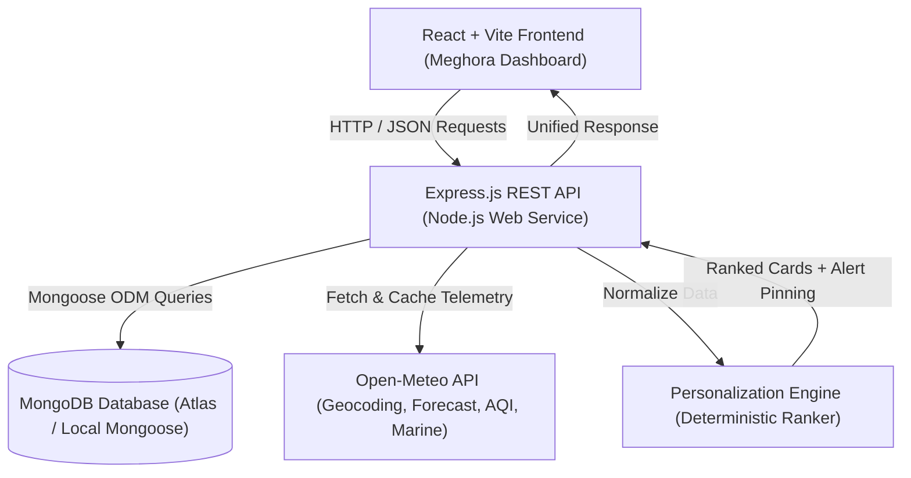

# 🌦️ Meghora — Personalized Weather Intelligence (MERN Stack)

> **Modern Weather Intelligence Platform**  
> **SIH Problem Statement ID:** SIH26076  
> **Original Reference:** Development of personalized homepage for “Mausam” mobile application  
> **Category:** Software — Smart Automation  
> **Stack:** MongoDB, Express.js, React, Node.js (MERN)  

---

## 📌 Executive Summary & Objectives

Conventional weather applications present an identical grid of meteorological figures to every citizen regardless of their lifestyle, vocation, or sensitivity to environmental factors.

**Meghora** transforms weather forecasting into a **smart, automated, context-aware personalized dashboard**. It dynamically computes and personalizes weather insights tailored to eight distinct citizen personas, while ensuring that official, verified severe-weather warnings always take top priority.

### Key Innovations:
1. **Multi-Profile Citizen Segmentation:** Supports 8 distinct profiles with multiple simultaneous selections.
2. **Deterministic Personalization Engine:** Ranks meteorological insights using an explainable mathematical formula:
   $$\text{Score} = 5 \times P + 2 \times T + 2 \times L + 3 \times W$$
3. **Severe Weather Alert Prioritization:** Pins verified, active warnings above all personalized cards.
4. **Data Integrity & Non-Fabrication:** Integrates real Open-Meteo telemetry (WMO standards). Missing metrics are never spoofed as zero; transparent offline fallbacks and unavailable badges are rendered instead.
5. **Persistent MongoDB + Mongoose Storage:** Synchronizes user profile configurations, favorite locations, telemetry snapshots, and verified alerts using Mongoose ODM with automated indexing.
6. **Graceful Connection Handling:** Accurately reports connection state at `/api/health` without false claims and cleanly returns `503 Service Unavailable` when the database is offline.

---

## 🏛️ System Architecture



---

## 👥 The 8 Supported User Profiles

| Profile Name | ID | Key Monitored Metrics | Practical Recommendation Example |
| :--- | :--- | :--- | :--- |
| **Health-Conscious Users** | `health` | US AQI, PM2.5, PM10, UV Index, Humidity | N95 mask advisory during high AQI, SPF 30+ reminder |
| **Outdoor Fitness Enthusiasts** | `outdoor_fitness` | Air Temp, Wind Speed, Golden Hour Sunset, Rain | Best morning/evening cardio windows, hydration alert |
| **Beachgoers & Surfers** | `beach` | Wave Height, Swell Period, Wind Speed, UV | Marine swell advisories, lifeguard beach safety zones |
| **Travelers** | `travel` | 3-Day Outlook, Peak Rain Risk, Diurnal Shift | Dynamic packing advice (waterproof shoes vs light layers) |
| **Parents & Families** | `family` | School departure temp (8 AM), Pickup rain risk (3 PM) | School commute rain covers, park/playground windows |
| **Farmers & Gardeners** | `agriculture` | Rain accumulation (mm), Wind drift speed, Pressure | Fertilizer/pesticide spraying window, irrigation hold |
| **Daily Commuters** | `commuter` | Visibility/fog (WMO code), Road surface rain risk | Low-beam fog advisory, traffic delay buffer times |
| **Event Planners** | `event_planner` | Rain probability, Peak wind gusts, Thermal comfort | Marquee canopy recommendations, wind bracing alerts |

---

## 🧮 Personalization Engine Scoring Algorithm

Each card is evaluated using four normalized factors ($0.0 \text{ to } 5.0$):
* **Profile Relevance ($P$):** $5.0$ if the card matches any of the user's active profiles; $1.0$ baseline otherwise.
* **Time Relevance ($T$):** Evaluates diurnal alignment (e.g., commute morning rush 7–10 AM = 5, evening family play = 5).
* **Location Relevance ($L$):** Station proximity & geographic suitability (e.g., coastal buoy data = 5, inland = 0).
* **Weather Relevance ($W$):** Real-time severity (e.g., AQI > 150 = 5, rain > 60% = 5).

$$\text{Raw Score} = 5P + 2T + 2L + 3W \quad (\text{Max Score} = 60)$$
$$\text{Display Match Percentage} = \text{round}\left(\frac{\text{Raw Score}}{60} \times 100\right)$$

*Every card includes an expandable **"Why this card?"** drawer demonstrating this exact score breakdown.*

---

## 🛠️ Technology Stack

* **Frontend:** React 19, Vite 8, Lucide React icons, CSS3 Meghora design tokens.
* **Backend:** Node.js, Express.js (ES Modules), CORS, Dotenv, Mongoose ODM (`^9.11.4`).
* **Database:** MongoDB (Local `mongod` or MongoDB Atlas Cloud Database).
* **Weather Integration:** Open-Meteo Geocoding, Forecast, Air Quality & Marine Telemetry (WMO standards).
* **Testing:** Node.js native test runner (`node:test`, `node:assert/strict`) with 20 unit and integration tests.
* **Deployment:** Render (Static Site + Node Web Service + MongoDB Atlas).

---

## 📂 Project Structure

```
mausam-personalized/
├── backend/
│   ├── src/
│   │   ├── config/
│   │   │   ├── database.js          # Mongoose connection manager & health probe
│   │   │   └── seed.js              # Initial demo preferences & alert seeder
│   │   ├── controllers/
│   │   │   ├── alerts.controller.js # Mongoose WeatherAlert query controller
│   │   │   ├── homepage.controller.js # Aggregated homepage feed controller
│   │   │   ├── locations.controller.js# Saved locations CRUD controller
│   │   │   ├── preferences.controller.js # User preferences & profiles controller
│   │   │   └── weather.controller.js# Telemetry fetch & geocoding controller
│   │   ├── middleware/
│   │   │   ├── errorHandler.js      # Handles Mongoose errors (Cast, 11000, 503)
│   │   │   └── validateRequest.js   # Input validation
│   │   ├── models/
│   │   │   ├── index.js             # Model barrel export
│   │   │   ├── SavedLocation.js     # SavedLocation Mongoose model
│   │   │   ├── UserPreference.js    # UserPreference Mongoose model
│   │   │   ├── WeatherAlert.js      # WeatherAlert Mongoose model
│   │   │   └── WeatherSnapshot.js   # WeatherSnapshot model with 30-min TTL
│   │   ├── routes/
│   │   │   ├── alerts.routes.js
│   │   │   ├── health.routes.js     # Honest DB connection status reporting
│   │   │   ├── homepage.routes.js
│   │   │   ├── locations.routes.js
│   │   │   ├── preferences.routes.js
│   │   │   └── weather.routes.js
│   │   ├── services/
│   │   │   ├── personalization.service.js # 8-Profile scoring & ranking engine
│   │   │   └── weather.service.js         # Open-Meteo API integration & caching
│   │   ├── app.js                   # Express application setup
│   │   └── server.js                # Server entrypoint with DB connection & seeding
│   ├── tests/
│   │   ├── api.test.js              # API route, validation & Mongoose model tests
│   │   └── personalization.test.js  # Algorithm, scoring & alert priority tests
│   ├── db_backup_postgres/          # Preserved PostgreSQL legacy files (pool.js, schema.sql)
│   ├── .env.example
│   ├── .env
│   ├── .gitignore
│   └── package.json
│
├── frontend/
│   ├── src/
│   │   ├── assets/
│   │   ├── components/
│   │   │   ├── AlertBanner.jsx      # Pinned verified severe warnings
│   │   │   ├── CurrentWeather.jsx   # Live telemetry, temperature & conditions
│   │   │   ├── ErrorState.jsx       # Error card with retry
│   │   │   ├── ForecastSection.jsx  # 24-Hour & 5-Day forecast outlooks
│   │   │   ├── LoadingState.jsx     # Shimmer skeleton loaders
│   │   │   ├── ProfileSelector.jsx  # Interactive 8-profile multi-select modal
│   │   │   ├── SavedLocations.jsx   # Favorite cities management modal
│   │   │   ├── WeatherCard.jsx      # Personalized cards with score transparency
│   │   │   └── WeatherHeader.jsx    # Branding, city search, unit switch
│   │   ├── pages/
│   │   │   └── HomePage.jsx         # Primary dashboard view & state manager
│   │   ├── services/
│   │   │   └── api.js               # REST API client
│   │   ├── utils/
│   │   │   └── temperature.js       # °C / °F conversion helper
│   │   ├── App.css                  # Meghora design system
│   │   ├── App.jsx
│   │   ├── index.css
│   │   └── main.jsx
│   ├── .env.example
│   ├── .env
│   ├── .gitignore
│   ├── index.html
│   ├── package.json
│   └── vite.config.js
│
├── render.yaml                      # Render Blueprint deployment config
├── .gitignore
└── README.md
```

---

## 🗄️ MongoDB Collections & Mongoose Models

The application uses four Mongoose collections defined under [`backend/src/models`](backend/src/models):

### 1. `UserPreference` (`userpreferences` collection)
Stores user configuration, active personas, preferred city, and notification flags.
* `userId`: String (indexed, required, unique)
* `preferred_city`: String (defaults to `"New Delhi"`)
* `temperature_unit`: String (`"celsius"` or `"fahrenheit"`)
* `language`: String (`"en"`, `"hi"`)
* `profiles`: Array of Strings (validated against 8 valid persona IDs)
* `categories`: Array of Strings
* `notifications`: Boolean
* Timestamps: `createdAt`, `updatedAt`
* Virtual aliases: `city`, `unit`, `user_id`

### 2. `SavedLocation` (`savedlocations` collection)
Stores bookmarked favorite cities for each user.
* `userId`: String (required, indexed)
* `city_name`: String (required, trimmed)
* `state`: String
* `country`: String
* `latitude`: Number (required)
* `longitude`: Number (required)
* `is_favorite`: Boolean (default: `true`)
* Compound unique index: `{ userId: 1, city_name: 1 }` with case-insensitive collation

### 3. `WeatherSnapshot` (`weathersnapshots` collection)
Stores cached Open-Meteo observations to minimize redundant external API calls.
* `city`: String (required, indexed)
* `latitude`: Number, `longitude`: Number
* `temperature`: Number (required)
* `weatherCondition`: String (required)
* `metrics`: Object (humidity, windSpeed, aqi, uvIndex, waveHeight)
* `dataSource`: String (default: `"Open-Meteo"`)
* `fetchedAt`: Date (default: `Date.now`)
* TTL Index: `{ fetchedAt: 1 }` with expiration after 1800 seconds (30 minutes)

### 4. `WeatherAlert` (`weatheralerts` collection)
Stores verified meteorological alerts and coastal advisories.
* `city`: String (required, indexed)
* `event`: String (required, virtual alias `title`)
* `headline`: String (required)
* `description`: String (required)
* `severity`: String (enum: `['severe', 'warning', 'watch', 'advisory']`)
* `is_verified`: Boolean (default: `false`, indexed)
* `source`: String (default: `"IMD / INCOIS"`)
* `precautions`: Array of Strings
* `effective_from`: Date (virtual alias `startTime`)
* `effective_to`: Date (virtual alias `endTime`)

---

## 📡 REST API Documentation

### 1. Health Check
* **`GET /api/health`**
* **Response:**
  ```json
  {
    "status": "healthy",
    "service": "Meghora Personalized Weather API",
    "uptime": 120,
    "database": {
      "status": "connected",
      "type": "mongodb",
      "readyState": 1,
      "host": "127.0.0.1",
      "name": "meghora"
    }
  }
  ```

### 2. Aggregated Personalized Homepage Feed
* **`GET /api/homepage?city=Mumbai&userId=demo-user`**
* Returns weather telemetry, active severe alerts, and the full list of cards ranked by score.

### 3. Weather Telemetry
* **`GET /api/weather?city=New Delhi`**
* Returns current observations, 24-hour forecast, 5-day daily forecast, air quality indices, and marine buoy data.

### 4. User Preferences
* **`GET /api/preferences/:userId`**
* **`PUT /api/preferences/:userId`**
* **Payload:**
  ```json
  {
    "profiles": ["health", "commuter", "outdoor_fitness"],
    "preferred_city": "Mumbai",
    "temperature_unit": "celsius"
  }
  ```

### 5. Saved Locations
* **`GET /api/locations/:userId`**
* **`POST /api/locations/:userId`** — Body: `{"city_name": "Bengaluru", "latitude": 12.9716, "longitude": 77.5946, "is_favorite": true}`
* **`DELETE /api/locations/:userId/:locationId`**

### 6. Official Weather Alerts
* **`GET /api/alerts?city=Mumbai`**

---

## 💻 Local Development Setup

### Prerequisites
* **Node.js**: v18 or higher (v24 tested)
* **npm**: v9 or higher
* **MongoDB**: Either a local MongoDB instance (`mongod`) or a free [MongoDB Atlas](https://www.mongodb.com/cloud/atlas) cloud cluster connection string.

### Step 1: Configure Environment Variables

In `backend/.env`:
```env
PORT=5000
NODE_ENV=development
FRONTEND_URL=http://localhost:5173
MONGODB_URI=mongodb://127.0.0.1:27017/meghora
```
*(If using MongoDB Atlas, replace `MONGODB_URI` with your connection string: `mongodb+srv://<user>:<password>@cluster0.xxxxx.mongodb.net/meghora?retryWrites=true&w=majority`)*

In `frontend/.env`:
```env
VITE_API_URL=http://localhost:5000
```

### Step 2: Start the Backend (Terminal 1)
```bash
cd backend
npm install
npm run dev
```
*Backend runs at:* `http://localhost:5000`  
*Health Check:* `http://localhost:5000/api/health`

### Step 3: Start the Frontend (Terminal 2)
```bash
cd frontend
npm install
npm run dev
```
*Frontend runs at:* `http://localhost:5173`

---

## 🧪 Running Tests & Quality Verification

Run backend test suite (20 tests covering API, Mongoose models, and Personalization scoring):
```bash
npm test --prefix backend
```
*20/20 tests passing:*
* API health & database status reporting
* Missing parameter and invalid enum validations
* Preference persistence and graceful 503 handling when offline
* Open-Meteo geocoding and non-fabrication guarantees
* 5 Mongoose schema & model validation tests
* 8 Personalization scoring algorithm & alert prioritization tests

Run frontend production build:
```bash
npm run build --prefix frontend
```

---

## 🚀 Render Deployment Guide

The repository includes a [`render.yaml`](render.yaml) file for Render Blueprint deployment.

### Blueprint Deployment:
1. Push this repository to GitHub.
2. In Render Dashboard, click **New +** -> **Blueprint**.
3. Connect your repository.
4. Render configures:
   * **Backend:** `meghora-backend` (Node Web Service)
   * **Frontend:** `meghora-frontend` (Static Site with `dist` publish path)
5. Set `MONGODB_URI` in the `meghora-backend` environment settings to your MongoDB Atlas connection string.

---

## 🎓 Viva Questions & Key Architectural Explanations

### Q1: Why did we migrate from PostgreSQL to MongoDB?
**Answer:** A personalized weather platform manages heterogeneous, evolving data types: user persona selections, nested daily/hourly forecasts, varying sensor metrics (marine vs inland), and caching TTLs. MongoDB's document model paired with Mongoose provides:
1. Natural JSON document storage matching frontend representations without joins.
2. Native Time-To-Live (TTL) indexing (`weathersnapshots`) for automatic cache invalidation after 30 minutes.
3. Flexible schemas allowing new profile categories and alerts without migrations.
4. Native support for MongoDB Atlas cloud scaling.

### Q2: How does the scoring formula work?
**Answer:** We use the deterministic formula:
$$\text{Score} = 5P + 2T + 2L + 3W$$
* $P$ (Profile Relevance, weight 5): Maximizes the citizen's chosen persona.
* $T$ (Time Relevance, weight 2): Accounts for morning rush hours, midday UV peaks, or evening workouts.
* $L$ (Location Relevance, weight 2): Adjusts for geography (e.g., coastal buoy data vs inland stations).
* $W$ (Weather Severity, weight 3): Escalates high impact conditions like heavy rain, extreme heat, or hazardous AQI.

### Q3: How do you handle missing or offline data without fabricating measurements?
**Answer:** Meteorological telemetry must never be invented. When coastal buoy data is unavailable for an inland city or an AQI station is offline, the system sets `dataStatus: "unavailable"` and renders an honest *"Telemetry Unavailable"* badge instead of misleading the user with a 0 value.

### Q4: How is database persistence and failure handling designed with Mongoose?
**Answer:** Connections are handled by `backend/src/config/database.js` using Mongoose with managed connection pools, buffered timeouts, and auto-seeding on initial boot (`backend/src/config/seed.js`). If MongoDB is unreachable, the system does not crash or hang; `/api/health` accurately reports `status: "disconnected"` and controllers return `503 Service Unavailable`.
